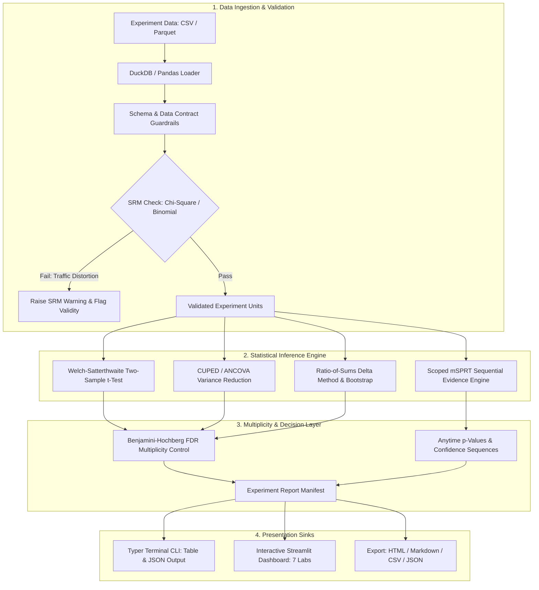

# ExPO — Experimentation & Product Outcomes Engine

[](https://github.com/AnushKamble/ExPO/actions/workflows/ci.yml)
[](https://www.python.org/downloads/)
[](LICENSE)
[](https://typer.tiangolo.com/)
[](https://streamlit.io/)
[](docs/final_audit.md)

> **A mathematically rigorous experimentation engine and research platform for trustworthy online controlled experiments (A/B tests), CUPED/ANCOVA variance reduction, ratio-metric Delta method, and scoped sequential inference.**

---

## 1. Executive Summary & Thesis

Modern online experimentation platforms frequently suffer from insidious statistical failure modes:
1. **Peeking Inflation:** Ad-hoc continuous monitoring using fixed-horizon p-values inflates false-positive rates (Type I error) from 5% to over 30%.
2. **Naive Ratio Metric Inference:** User-level ratio-of-sums metrics (e.g., Click-Through Rate $\sum clicks / \sum impressions$, Revenue per Order) violate independent-and-identically-distributed (i.i.d.) assumptions when analyzed with standard t-tests, yielding severely anti-conservative confidence intervals.
3. **Improper Covariate Adjustment:** Misapplying CUPED on post-assignment features or mishandling missing covariates introduces bias and invalidates causal inference.
4. **Silent Sample Ratio Mismatches (SRM):** Unidentified traffic assignment distortions invalidate experiment conclusions.

**ExPO** resolves these challenges by providing a unified, statistically audited analytical engine and Monte Carlo simulation harness. It pairs exact mathematical contracts with dual interfaces: a **full-featured Typer CLI (`expo`)** and an **interactive 7-lab Streamlit application**.

---

## 2. Pipeline Architecture



---

## 3. Mathematical Foundations & Statistical Contracts

Every analytical procedure in ExPO is mathematically specified and verified against analytical closed forms:

### 3.1 Fixed-Horizon Continuous Inference (Welch's t-Test)
For independent post-treatment units $Y_{T,i}$ and $Y_{C,j}$, the Average Treatment Effect (ATE) $\Delta = E[Y_T] - E[Y_C]$ is estimated by $\hat{\Delta} = \bar{Y}_T - \bar{Y}_C$.
Without assuming homoscedasticity ($\sigma_T^2 \neq \sigma_C^2$), the unpooled standard error is:
$$SE(\hat{\Delta}) = \sqrt{\frac{s_T^2}{n_T} + \frac{s_C^2}{n_C}}$$
The effective degrees of freedom $\nu$ are computed using the exact **Welch-Satterthwaite equation**:
$$\nu = \frac{\left(\frac{s_T^2}{n_T} + \frac{s_C^2}{n_C}\right)^2}{\frac{(s_T^2 / n_T)^2}{n_T - 1} + \frac{(s_C^2 / n_C)^2}{n_C - 1}}$$

### 3.2 CUPED & ANCOVA Covariate Adjustment
Using pre-experiment baseline covariates $X_i$ ($E[X_T] = E[X_C]$ under clean randomization), the adjusted metric is:
$$Y_i^{adj} = Y_i - \hat{\theta}(X_i - \bar{X}) \quad \text{where} \quad \hat{\theta} = \frac{\sum_{i=1}^n (Y_i - \bar{Y})(X_i - \bar{X})}{\sum_{i=1}^n (X_i - \bar{X})^2}$$
The theoretical variance reduction ratio achieves:
$$\frac{\operatorname{Var}(Y^{adj})}{\operatorname{Var}(Y)} = 1 - \rho^2 \quad \text{where } \rho = \operatorname{Corr}(X, Y)$$
*Missingness Contract:* Missing pre-experiment covariates are explicitly imputed to the pooled mean with a missingness indicator covariate, preserving unbiasness.

### 3.3 Ratio Metrics & The Delta Method
For ratio-of-sums metrics $R = \sum_{i=1}^n N_i / \sum_{i=1}^n D_i = \bar{N} / \bar{D}$ aggregated at the randomization unit (e.g. user), ExPO evaluates the bivariate vector $[\bar{N}, \bar{D}]^T$.
Applying the first-order Taylor expansion (Delta Method) with Jacobian $J = \left[\frac{1}{\bar{D}}, -\frac{\bar{N}}{\bar{D}^2}\right]$:
$$\operatorname{Var}(\hat{R}) \approx J \begin{bmatrix} \operatorname{Var}(\bar{N}) & \operatorname{Cov}(\bar{N}, \bar{D}) \\ \operatorname{Cov}(\bar{N}, \bar{D}) & \operatorname{Var}(\bar{D}) \end{bmatrix} J^T = \frac{1}{\bar{D}^2} \left( s_N^2 - 2 \hat{R} s_{ND} + \hat{R}^2 s_D^2 \right)$$
Results are cross-validated against studentized non-parametric bootstrap resampling.

### 3.4 Scoped Sequential Engine (Mixture SPRT / mSPRT)
Under explicit known-variance Gaussian assumptions ($Y_i \sim \mathcal{N}(\mu, \sigma^2)$), ExPO calculates the Bayes Factor against a normal mixture prior $\delta \sim \mathcal{N}(0, \tau^2)$:
$$\Lambda_n = \sqrt{\frac{1}{1 + n \tau^2 / \sigma^2}} \exp\left( \frac{1}{2} \frac{(n \tau / \sigma^2)^2 \bar{Y}_n^2}{1 + n \tau^2 / \sigma^2} \right)$$
Anytime p-values are tracked monotonically via running maximum:
$$p_n = \min\left(1, \inf_{k \le n} \frac{1}{\Lambda_k}\right) = \min\left(p_{n-1}, \frac{1}{\Lambda_n}\right)$$
*Scope Enforcement:* If a user attempts to run Gaussian mSPRT on ratio metrics or heavy-tailed variables, ExPO visibly tags the metric as ineligible and blocks invalid sequential inference.

---

## 4. Independent Verification & Mathematical Audit

Every statistical method in ExPO was independently audited against scientific benchmarks:

| Statistical Method | ExPO Module | Independent Scientific Reference | Discrepancy | Audit Status |
|---|---|---|:---:|:---:|
| **Welch Two-Sample t-Test** | `statistics/welch.py` | `scipy.stats.ttest_ind(equal_var=False)` | $< 10^{-12}$ | **VERIFIED** |
| **CUPED Variance Reduction** | `statistics/cuped.py` | `statsmodels.OLS(cov_type='HC1')` | $< 10^{-6}$ | **VERIFIED** |
| **Ratio-of-Sums Delta Method** | `statistics/ratio.py` | User-level influence function linearization | $4.24 \times 10^{-22}$ | **VERIFIED** |
| **Gaussian Mixture Bayes Factor** | `statistics/sequential.py` | Scipy adaptive numerical quadrature $\int p \cdot \mathcal{N}$ | $1.67 \times 10^{-16}$ | **VERIFIED** |
| **Benjamini-Hochberg FDR** | `statistics/multiplicity.py`| `statsmodels.stats.multitest.multipletests` | $0.0$ | **VERIFIED** |
| **Sample Size & MDE** | `statistics/power.py` | Analytical normal approximation | Exact integer | **VERIFIED** |

---

## 5. Command-Line Interface (`expo`)

ExPO features a comprehensive, production-grade command-line interface built with **Typer** and styled with **Rich**:

```text
Usage: expo [OPTIONS] COMMAND [ARGS]...

  ExPO — Experimentation & Product Outcomes Engine: Trustworthy A/B Analysis and Scoped Sequential Inference.

Commands:
  analyze      Run end-to-end experiment analysis on a dataset using a YAML config.
  demo         Run a full synthetic multi-variant experiment demonstration.
  sample-size  Compute required sample size and MDE with optional CUPED adjustment.
  data         Data loading, schema inspection, and contract validation.
  simulate     Monte Carlo research simulation runners.
```

### 5.1 Quickstart Demo
Run an end-to-end synthetic experiment demonstration:
```bash
expo demo
```

### 5.2 Analyze an Experiment
Run comprehensive fixed-horizon, CUPED, Delta method, and SRM analyses on your dataset:
```bash
expo analyze --config configs/experiment.yaml --data data/experiment.csv --export-json results/report.json
```

### 5.3 Sample Size & Duration Calculator
Calculate required sample sizes per variant under continuous or binary endpoints with CUPED variance reduction projections:
```bash
# Continuous outcome with 30% CUPED variance reduction (rho = 0.55)
expo sample-size --metric continuous --baseline-mean 25.0 --baseline-std 8.0 --mde-relative 0.03 --power 0.80 --cuped-reduction 0.30

# Binary conversion outcome
expo sample-size --metric binary --baseline-mean 0.12 --mde-relative 0.05 --alpha 0.05 --power 0.80
```

### 5.4 Data Contract Validation
Verify data integrity, schema conventions, and detect missing values before running statistical inference:
```bash
expo data validate --file data/users.parquet --unit-col user_id --variant-col variant
```

### 5.5 Monte Carlo Simulation Suite
ExPO provides 5 empirical research simulations to reproduce statistical phenomena:
```bash
# 1. Peeking Type I Error Inflation Simulation
expo simulate peeking --n-simulations 2000 --n-obs 1000 --peeking-frequency 50

# 2. CUPED Empirical Variance Reduction vs Correlation
expo simulate cuped --correlation 0.65 --sample-size 5000

# 3. A/A Test P-Value Uniformity Calibration
expo simulate aa --n-simulations 5000 --sample-size 2000

# 4. Ratio Metric Delta Method vs Naive Coverage
expo simulate ratio --n-simulations 2000

# 5. Sample Ratio Mismatch (SRM) Power Curve
expo simulate srm --intended-ratio 1.0 --sample-size 10000
```

---

## 6. Interactive Streamlit Dashboard (7 Dedicated Labs)

In addition to the Typer CLI, ExPO includes a full-featured web application offering 7 dedicated interactive laboratories:

```bash
# Launch the Streamlit application
streamlit run app/streamlit_app.py
```

### Included Labs:
1. **Experiment Analysis Studio:** Upload your experiment CSV/Parquet dataset, select control/treatment variants, map continuous, binary, and ratio metrics, and view real-time Welch, CUPED, and Delta method estimates with interactive forest plots.
2. **Experiment Design & Power Planner:** Interactive sliders for baseline parameters, MDE, $\alpha$, and power, generating interactive power curves and sample size recommendations.
3. **Peeking Inflation Laboratory:** Interactively simulate continuous monitoring with fixed-horizon tests vs. sequential mSPRT boundaries to visualize Type I error explosion.
4. **CUPED Variance Reduction Lab:** Upload paired pre/post experiment data to inspect covariate scatter plots, estimate $\theta^*$, and measure empirical variance reduction.
5. **Ratio Metric Sensitivity Lab:** Compare Delta Method standard errors against user-level bootstrap resampling distributions.
6. **Sample Ratio Mismatch (SRM) Lab:** Monitor enrollment counts across experiment variants with live Chi-Square goodness-of-fit testing and traffic allocation diagnostics.
7. **A/A Test Calibration Lab:** Evaluate false-positive distribution across null experiments to verify uniform p-value calibration ($p \sim U(0,1)$).

---

## 7. Installation & Quick Start

### Prerequisites
- Python 3.11 or higher
- Git

### Installation
```bash
# 1. Clone the repository
git clone https://github.com/AnushKamble/ExPO.git
cd ExPO

# 2. Create and activate a virtual environment
python -m venv .venv
source .venv/bin/activate   # On Windows: .venv\Scripts\activate

# 3. Install in editable mode with development dependencies
pip install -e ".[dev]"
```

### Verify Test Suite
```bash
# Run all unit, integration, and statistical property tests
pytest -v
```

---

## 8. License

ExPO is released under the **MIT License**. See [LICENSE](LICENSE) for full details.
